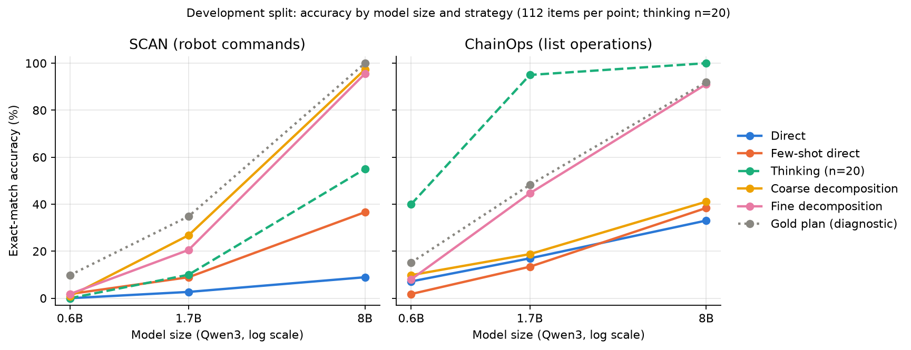

# Final Project Milestone 3

**Learning When to Decompose Complex Tasks for Local Language Models**

**Team member:** Jefferson Kline · **Course:** CS 437, Machine Learning

**Code and data:** [github.com/JeffLepp/learning-when-to-decompose](https://github.com/JeffLepp/learning-when-to-decompose)

## 1. Working baseline and initial model

### Research questions

1. When does breaking a task into smaller pieces (decomposition) let a *small, locally run* language model solve tasks it otherwise fails?
2. Can a machine-learning model predict, before running anything, which model and strategy will succeed most cheaply?

### Tasks

| Task | Example input | Why it was chosen |
| --- | --- | --- |
| SCAN | `jump around left twice and walk` → robot actions | Standard compositional benchmark |
| ChainOps | "Start with [3, 8, 1, 5]. Reverse the list. Then remove every odd number." | New synthetic task, so no model can have memorized it |

### Models and strategies

Four local Qwen3 models (0.6B, 1.7B, 4B, 8B) attempt every item with every strategy:

| Strategy | What happens |
| --- | --- |
| Direct / few-shot (baselines) | The model answers in one step, with or without worked examples |
| Thinking | The model reasons privately before answering |
| Coarse decomposition | The model plans clause-sized pieces and solves each; code combines them |
| Fine decomposition | The model parses the full structure and solves only tiny pieces |
| Gold plan (diagnostic only) | The correct plan is supplied, which isolates execution errors from planning errors |

### Initial learned model

A logistic-regression router trained on an 8B pilot (96 training, 32 validation, 32 test commands) predicts whether decomposition is needed. It used 6.9% fewer tokens than always decomposing, but got one fewer answer right (15/32 vs. 16/32). The expanded router adds richer features, including the model's internal activations.

## 2. Quantitative result and visualization

### Accuracy by model size and strategy

| Task | Model | Direct | Few-shot | Coarse decomp. | Fine decomp. | Thinking* |
| --- | --- | ---: | ---: | ---: | ---: | ---: |
| SCAN | 0.6B | 0.0% | 1.8% | 0.9% | 1.8% | 0% |
| SCAN | 1.7B | 2.7% | 8.9% | 26.8% | 20.5% | 10% |
| SCAN | 8B | 8.9% | 36.6% | **97.3%** | 95.5% | 55% |
| ChainOps | 0.6B | 7.1% | 1.8% | 9.8% | 8.0% | 40% |
| ChainOps | 1.7B | 17.0% | 13.4% | 18.8% | 44.6% | **95%** |
| ChainOps | 8B | 33.0% | 38.4% | 41.1% | 91.1% | 100% |

*Exact-match accuracy on the development split: 112 items per cell, thinking 20 items. Example 95% interval: SCAN 8B coarse decomposition, 92.4–99.1%.*

### Cost

Decomposition at 8B uses about 4–5× the tokens of a direct answer (roughly 1,200–1,800 vs. 260–370). Thinking is similar in tokens but far slower: about 25 s per SCAN item at 8B, compared with about 1 s for decomposition.

### Early machine-learning result

This test predicts whether decomposition will succeed for the 8B model, using 128 pilot commands and cross-validation.

| Features used | AUROC (0.5 = chance) |
| --- | ---: |
| Model's internal activations, before generating | 0.855 |
| Word frequencies (TF-IDF) | 0.834 |
| Simple structural counts | 0.787 |

## 3. What was run and what we observed

**What was run:**

- The data was split into development, router-training, validation, holdout, and out-of-distribution partitions before any model was run.
- Prompts were tuned on the development split only, within a fixed and logged budget of rounds. Direct and decomposition prompts received comparable effort.
- All model × strategy combinations were then run on the development split.

**What we observed:**

1. **Decomposition transforms capable models.** The 8B model goes from 9% (direct) to 97% (coarse decomposition) on SCAN, and from 33% to 91% (fine decomposition) on ChainOps.
2. **There is a capability floor.** With the correct plan supplied, the 0.6B model still scores only 10% on SCAN, so it cannot reliably execute steps as small as "jump left". At 8B, gold-plan execution is perfect. All of its remaining errors are therefore planning errors.
3. **Thinking competes with decomposition, depending on the task.** On ChainOps, 1.7B with thinking (95%, n=20) matches 8B with decomposition. Model size and inference compute can partly substitute for each other, but not below the floor.
4. **The router's room is mostly in cost, not accuracy.** On development data, a perfect router over the direct and decomposition strategies would add under one point of accuracy over the best single strategy (SCAN 98.2% vs. 97.3%). It would also use 25% fewer tokens (1,056 vs. 1,399). On ChainOps the saving is 36% (1,144 vs. 1,790 tokens). The learned router must capture part of that saving by predicting which items a cheaper model or strategy can handle.
5. **Reading the model's hidden state predicts its failures** better than structural features. This is consistent with recent work (Lugoloobi et al., ICLR 2026). At this sample size, though, it is not clearly better than word-frequency features.

## 4. Important issues discovered

- **A model-release mismatch.** Ollama's `qwen3:4b` turned out to be a later, thinking-only release (2507), not the same Qwen3 release as the other sizes. That would have confounded the size comparison. It was replaced with the original Qwen3-4B; its development results are being rerun and are omitted above.
- **Optimistic numbers.** Development results guided prompt design, so they are optimistic. Headline claims will come only from a fresh 400-item holdout and from out-of-distribution tests (longer SCAN commands, deeper ChainOps chains), each evaluated once after the design is frozen.
- **Weak direct baselines on SCAN.** Direct prompting stayed weak on SCAN despite three logged prompt-improvement rounds. SCAN is known to be hard to solve in one pass, but the gap should be read as "these prompts", not as a limit of the models.
- **Plan validity.** Small models often produce malformed plans: 32–48% of coarse ChainOps plans at 0.6B and 1.7B are invalid. These count as failures. They are a real weakness of small models, partly amplified by strict format checking.
- **Thinking runs out of budget.** Thinking often hits its 2,048-token cap on SCAN (40% of 8B attempts). Truncation is reported as part of that strategy's cost.
- **Cost measurement.** Token counts are a cost proxy, not energy or FLOPs. Wall-clock times on a single shared GPU are reported but treated as secondary.
- **Routers often fail.** Many published routers do not beat simply using the best single strategy (LLMRouterBench, 2026). Our router is judged against that baseline and against a perfect-router upper bound, so a null result is possible and would be reported as one.

## 5. Next step

- **Collect the full dataset overnight:** about 1,200 items per task across all model and strategy combinations, including the corrected 4B model.
- **Train the router:** compare feature types (structural, word frequency, internal activations) and a cheap-first escalation strategy, against always using the best single strategy.
- **Evaluate once on held-out data,** including harder out-of-distribution items, after the design is frozen.
- **Write the final analysis:** decomposition and thinking as two ways to trade model size for compute.

## References

- Lake and Baroni (2018), [Generalization without systematicity](https://arxiv.org/abs/1711.00350); [SCAN dataset](https://github.com/brendenlake/SCAN).
- Zhou et al. (2022), [Least-to-Most Prompting](https://arxiv.org/abs/2205.10625). Decomposition on SCAN is prior work; this project studies small models and learned strategy selection.
- Lugoloobi et al. (ICLR 2026), [LLMs Encode Their Failures: Predicting Success from Pre-Generation Activations](https://arxiv.org/abs/2602.09924).
- [LLMRouterBench](https://arxiv.org/abs/2601.07206) (2026).
- Yue et al. (ICLR 2024), [LLM Cascades with Mixture of Thought Representations](https://arxiv.org/abs/2310.03094).
- Prasad et al. (NAACL Findings 2024), [ADaPT: As-Needed Decomposition and Planning](https://arxiv.org/abs/2311.05772).
- Snell et al. (2024), [Scaling LLM Test-Time Compute Optimally Can Be More Effective than Scaling Model Parameters](https://arxiv.org/abs/2408.03314).
